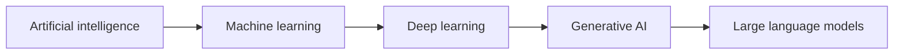

# Week 1: Introduction to AI

**COSC-300/500 Applied AI Essentials** · 4D focus: Delegation

## What You Will Be Able to Do

- Define artificial intelligence and explain why the definition keeps moving.
- Tell rule-based systems from systems that learn from data.
- Place machine learning, deep learning, generative AI, and large language models inside the wider field.
- Recognize AI that is already part of everyday tools, and say why "AI" in a product name tells you little.

## A Working Definition of AI

**Artificial intelligence (AI)** is a subfield of computer science that is interested in building computer systems that do tasks we would call intelligent if a person did them: understanding language, recognizing images, making predictions, planning, and solving problems.

That definition is deliberately loose, and the field's boundary keeps moving. When a task becomes routine for computers, people tend to stop calling it AI. A chess program that beat the world champion in 1997 was front-page AI news. Today the same ability sits in a free phone app, and few people would describe it that way. Spell checkers, route planners, and spam filters have all made the same trip from "AI" to "software."

For this course, a practical definition is enough: an AI system is one whose behavior was **learned from examples or data**, or that **decides among options** in a way that wasn't written out step by step by a programmer.

## From Machine Learning to Large Language Models

AI is a very broad field. It includes the expert systems that were popular in the past, search algorithms such as the tree-based methods that play chess, optimization methods such as genetic algorithms, and the data-driven models behind today's tools. For its first decades, the field relied mostly on rules written by people. Those systems were brittle, because anything the rules didn't anticipate broke them, and they were slow to build. Since about 2010, systems that learn from data have dominated. They tend to be more robust, and they can sometimes outperform hand-written rules. The History of AI page in the Appendix tells that story in more detail.

This course focuses on one narrow part of that field. It is the part that matters most today, and the part most people mean when they say "AI."

The terms you will see in this course are nested inside one another. Artificial intelligence is the broad field. Machine learning, where systems learn from data, sits inside it. Deep learning, which uses large neural networks, is a kind of machine learning. Generative AI, which produces new content, is a kind of deep learning. And large language models, which generate text, are a kind of generative AI. The diagram shows the nesting, and the list after it gives fuller definitions.

- **Machine learning** is the part of AI where systems learn from data instead of following hand-written rules.
- **Deep learning** is machine learning with **neural networks**: very large collections of simple, connected calculations whose strengths are adjusted during training. "Deep" refers to the many layers of these calculations.
- **Generative AI** is deep learning used to **produce** new content (text, images, audio, video, or code) instead of only sorting or scoring what already exists.
- **Large language models (LLMs)** are generative AI systems trained on huge amounts of text to predict and produce language. They power the chat assistants and most of the other AI tools in this course.

In this course, "AI tools" means applications built on large language models: chat assistants, writing and coding tools, and agents. Large language models are the subject of the next topic.

## AI You Already Use

You were almost certainly using AI long before LLM-driven systems arrived. It recommends your next show, routes your commute around traffic, sorts spam out of your inbox, and flags unusual charges on your card. Most of these systems do one narrow job, and many are machine learning models that classify or predict. Modern AI systems are different because they generate new content, and a single system can often handle a wide range of tasks.

More examples:

- **Recommendations** in streaming, shopping, and social media feeds.
- **Maps and navigation** that predict traffic and pick routes.
- **Your phone's camera**, which recognizes faces, sharpens low-light photos, and lets you search your photos by what's in them.
- **Speech recognition** in voice assistants, dictation, and automatic captions.
- **Fraud detection** that flags an unusual card purchase.
- **Autocomplete** in your keyboard and email.

Try sorting some examples below.

{{widget what-is-ai}}

## What "AI" Doesn't Tell You

Because the word is popular, it appears on products that range from a large language model to a simple set of rules, or to a feature that has existed for years under a different name. When a product says it uses AI, three questions tell you more than the label does:

- **What does it actually do?** Classify, predict, recommend, or generate?
- **What was it trained or built on?** Whose data, and how current is it?
- **What happens when it's wrong?** Who checks, and what does a mistake cost?

These questions come back all term. They are the start of the Delegation skill this week is about: deciding what to hand to an AI system at all.

## Further Reading

[The History of AI](/appendix/history-of-ai/), in the Appendix, follows the field from the first ideas about thinking machines through the booms and setbacks that led to today's language models. It is optional.

## Key Terms

- **Artificial intelligence (AI)**: a subfield of computer science that is interested in building computer systems that do tasks we would call intelligent if a person did them.
- **Rule-based system**: a system that follows rules written by people.
- **Machine learning**: the part of AI where systems learn from data instead of following hand-written rules.
- **Neural network**: a large collection of simple, connected calculations whose strengths are adjusted during training.
- **Deep learning**: machine learning that uses neural networks with many layers.
- **Generative AI**: AI that produces new content, such as text, images, audio, or code.
- **Large language model (LLM)**: a generative AI system trained on huge amounts of text to predict and produce language.
