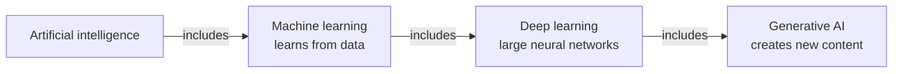

# Week 1: What Is AI?

**COSC-300/500 Applied AI Essentials** · 4D focus: Delegation

## What You Will Be Able to Do

- Define artificial intelligence and explain why the definition keeps moving.
- Tell rule-based systems from systems that learn from data.
- Place machine learning, deep learning, and generative AI inside the wider field.
- Recognize AI that is already part of everyday tools, and say why "AI" in a product name tells you little.

## A Working Definition

**Artificial intelligence (AI)** is the field of building computer systems that do tasks we would call intelligent if a person did them: understanding language, recognizing images, making predictions, planning, and solving problems.

That definition is deliberately loose, and the field's boundary keeps moving. When a task becomes routine for computers, people tend to stop calling it AI. A chess program that beat the world champion in 1997 was front-page AI news. Today the same ability sits in a free phone app, and few people would describe it that way. Spell checkers, route planners, and spam filters have all made the same trip from "AI" to "software."

For this course, a practical definition is enough: an AI system is one whose behavior was **learned from examples or data**, or that **decides among options** in a way that wasn't written out step by step by a programmer.

## Two Ways to Build It

Most AI systems are built in one of two broad ways, and many products combine them.

| | Rules written by people | Learned from data |
|---|---|---|
| **How it works** | Experts write the rules: "if the temperature is above 38°C and the patient has a cough, flag for review." | The system is shown many examples and adjusts itself until its answers match them. |
| **Strengths** | Predictable, and easy to explain and audit. | Handles messy, varied input that no one could write rules for, such as speech, photos, and ordinary writing. |
| **Weaknesses** | Brittle. Anything the rules didn't anticipate breaks it. Writing the rules is slow. | Needs a lot of data. Hard to explain why it gave a particular answer. Can absorb the biases in its examples. |
| **Examples** | Tax software, early medical expert systems, a bank's fraud rules | Speech recognition, photo search, recommendation feeds, chat assistants |

The field spent its first decades mostly on the first approach. Since about 2010 the second has dominated, because there is far more data and far more computing power than before. The History of AI page in the Appendix tells that story in more detail.

## Machine Learning, Deep Learning, and Generative AI

Several terms you will see in this course are nested inside one another.

- **Machine learning** is the part of AI where systems learn from data instead of following hand-written rules.
- **Deep learning** is machine learning with **neural networks**: very large collections of simple, connected calculations whose strengths are adjusted during training. "Deep" refers to the many layers of these calculations.
- **Generative AI** is deep learning used to **produce** new content (text, images, audio, video, or code) instead of only sorting or scoring what already exists.

A spam filter is machine learning that **classifies**: spam or not spam. A chat assistant is generative AI that **creates**: it writes a reply that didn't exist before. Large language models, the subject of the next topic, are the generative AI systems behind the chat tools in this course.

## AI You Already Use

Generative AI is the newest kind, but most of the AI in your life is older and quieter:

- **Recommendations** in streaming, shopping, and social media feeds.
- **Maps and navigation** that predict traffic and pick routes.
- **Your phone's camera**, which recognizes faces, sharpens low-light photos, and lets you search your photos by what's in them.
- **Speech recognition** in voice assistants, dictation, and automatic captions.
- **Fraud detection** that flags an unusual card purchase.
- **Autocomplete** in your keyboard and email.

Each of these is narrow: it does one kind of task. The chat assistants in this course are unusual because one system handles a very wide range of tasks through ordinary language.

Try sorting some examples below.

{{widget what-is-ai}}

## What "AI" Doesn't Tell You

Because the word is popular, it appears on products that range from a large language model to a simple set of rules, or to a feature that has existed for years under a different name. When a product says it uses AI, three questions tell you more than the label does:

- **What does it actually do?** Classify, predict, recommend, or generate?
- **What was it trained or built on?** Whose data, and how current is it?
- **What happens when it's wrong?** Who checks, and what does a mistake cost?

These questions come back all term. They are the start of the Delegation skill this week is about: deciding what to hand to an AI system at all.

## Further Reading

[The History of AI](/appendix/history-of-ai/), in the Appendix, follows the field from the first ideas about thinking machines through the booms and setbacks that led to today's language models. It is optional.

## Key Terms

- **Artificial intelligence (AI)**: the field of building computer systems that do tasks we would call intelligent if a person did them.
- **Rule-based system**: a system that follows rules written by people.
- **Machine learning**: the part of AI where systems learn from data instead of following hand-written rules.
- **Neural network**: a large collection of simple, connected calculations whose strengths are adjusted during training.
- **Deep learning**: machine learning that uses neural networks with many layers.
- **Generative AI**: AI that produces new content, such as text, images, audio, or code.
