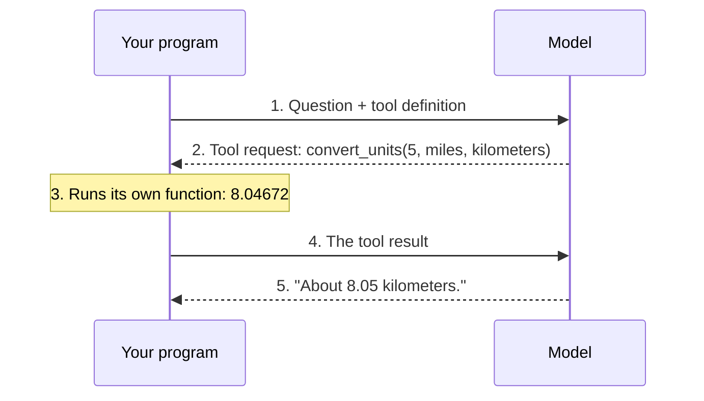

# Tool Use
### Week 11
COSC-300/500 Applied AI Essentials

---

## Tool Use

The model can't run code or look things up on its own. All it can do is produce text.

**Tool use** lets it ask *your program* to do it.

- You describe the tools your program offers: what each one does and what inputs it takes.
- The model replies with a request to use one, written in a fixed format.
- Your program decides whether to run it, runs it, and sends back the result.

---

## The Round Trip

1. You send a request **with tool definitions**
2. The model replies: *"call `get_weather` with city = St. Louis"*
3. **Your program** runs the function
4. You send the result back
5. The model writes the final answer

---

## Message by Message

"How far is a 5-mile run in kilometers?"



Two API calls. The arithmetic was done by ordinary code.

---

## The Program Is in Control

- It can **refuse** a request the model makes.
- It can **ask a person** first. Every approval prompt since week 6 works this way.
- It can **limit the loop**, so a confused model can't call tools forever.
- It should **check the inputs**: they're generated text, not trusted data.

A failed tool? Send the error back in plain words, and the model can often recover.

---

## A Tool Definition

```json
{
  "name": "convert_units",
  "description": "Convert a value between units of length.",
  "input_schema": {
    "type": "object",
    "properties": {
      "value": {"type": "number"},
      "from": {"type": "string"},
      "to": {"type": "string"}
    },
    "required": ["value", "from", "to"]
  }
}
```

---

## The Description Is the Trigger

| Description | Verdict |
|---|---|
| "Converts things." | Too vague |
| "Use for any unit conversion question." | Promises too much |
| "Convert a length between miles, km, meters, feet. Don't use for weight, temperature, or currency." | What, when, and when not |

Same lesson as skills in week 7.

---

## Demo: Trace the Message Blocks

- Run a small program with a calculator or weather tool.
- Print every message as it goes back and forth between the program and the model.
- Find the tool request, the tool result, and the final answer.
- Then break the tool on purpose, and watch what the model does with the error.
