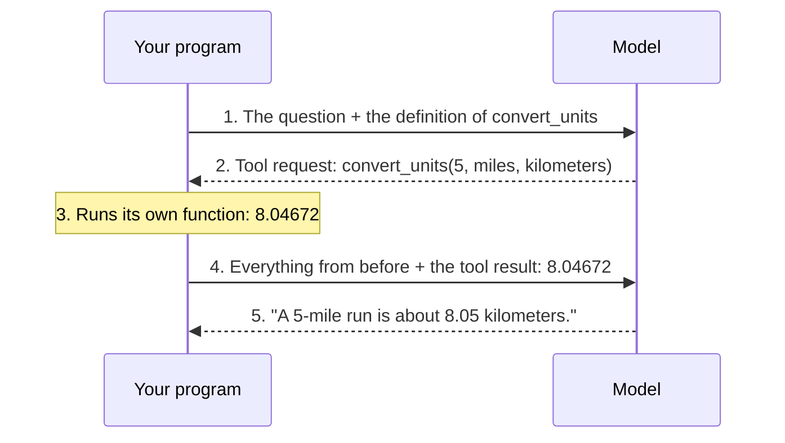

# Week 11: Tool Use

**COSC-300/500 Applied AI Essentials** · 4D focus: Description

> **Instructor note: preparation.** Prepare a demo program with one tool (a calculator or a fake weather lookup) that prints every message exchanged so the class can trace the round trip. Check the current tool-definition format for your API route. Timing: 20 min tool use, 10 min workflows vs agents, 35 min lab, 10 min share-out.

## What You Will Be Able to Do

- Explain tool use: the model asks for a tool, the program runs it, the result goes back.
- Trace the messages in one tool-use round trip.
- Write a tool description that tells the model when to use the tool.
- Explain why the program, and not the model, is in control of what runs.

A model on its own can only produce text. It can't look up today's weather, read a file, or do exact arithmetic reliably. **Tool use** (also called function calling) gives it a way to ask your program to do those things.

## The Round Trip

1. Your program sends a request that includes **tool definitions**: the name of each tool, a description, and the inputs it takes.
2. The model replies, not with an answer, but with a **tool request**: "call `convert_units` with value 5, from miles, to kilometers."
3. **Your program** runs the function.
4. Your program sends the **result** back to the model.
5. The model uses the result to write its final answer.

The model never runs anything itself. It asks. Your program decides whether and how to act.

### The Round Trip, Message by Message

Suppose the user asks, "How far is a 5-mile run in kilometers?" Here is what passes back and forth.



Two API calls were made, at steps 1 and 4. In step 2, the stop reason says the model is waiting for a tool. The model wrote the request in step 2 and the sentence in step 5. The arithmetic in step 3 was done by ordinary code, which is why the answer is exact. This is the same reason code execution was more reliable than model arithmetic in Week 5.

The model can also decline to use a tool. Asked "What's a good stretch after a run?", it answers directly, because nothing in the tool's description applies. And it can ask for several tools in a row, or more than one at once, before giving its final answer.

### The Program Is in Control

Because your program sits between the model's request and the action, your program is where the safeguards go:

- **It can refuse.** A tool request is a request. The program can check it first, and decline to delete a file outside the allowed folder.
- **It can ask a person.** Every approval prompt you've seen since Week 6 is a program pausing at step 3.
- **It can limit the loop**, stopping after a set number of tool calls so that a confused model can't run up a bill.
- **It should check the inputs.** The model's arguments are generated text, and they can be wrong or, after a prompt injection, hostile. Treat them as untrusted input, as in Week 8.

### When a Tool Fails

Tools fail: the file isn't there, the unit isn't recognized, the service is down. The program should send the error back to the model as the tool result, in plain words: "Unknown unit: furlongs. Supported units are miles, kilometers, meters, feet." A model given a clear error will usually correct itself or tell the user what went wrong. A model given nothing, or a crash, tends to guess. Try this in the lab.

## A Tool Definition

```json
{
  "name": "convert_units",
  "description": "Convert a length between units. Use for any unit conversion question.",
  "input_schema": {
    "type": "object",
    "properties": {
      "value": {"type": "number"},
      "from": {"type": "string"},
      "to": {"type": "string"}
    },
    "required": ["value", "from", "to"]
  }
}
```

A definition has three parts. The **name** identifies the tool. The **description** says what it does and when to use it. The **input schema** lists the inputs the tool takes and the type of each, in a format called JSON Schema, and names the ones that are required.

Notice the **description**. Just as with skills in Week 7, the model reads the description to decide when to use the tool. A vague description means the tool gets used at the wrong times, or not at all.

| Description | Problem |
|---|---|
| "Converts things." | The model can't tell what it converts or when it applies |
| "Convert a length between units. Use for any unit conversion question." | Promises more than the tool does. Asked to convert pounds to kilograms, the model may call it anyway. |
| "Convert a length between miles, kilometers, meters, and feet. Use when the user asks to convert a distance or length. Don't use for weight, temperature, or currency." | Says what it does, when to use it, and when not to |

Writing a tool description is the Description skill again, with a model as the reader. Inputs benefit from descriptions too: saying that `from` is "the unit to convert from, such as miles" prevents the model from sending "mi" when the code expects "miles".

> **Instructor note: demo.** Run your traced program. On screen, find the tool definition in the request, the tool request in the model's reply, the tool result your program sends back, and the final answer. Then ask a question that shouldn't need the tool and show that the model answers directly.

## Key Terms

- **Tool use (function calling)**: a model requesting that a program run a defined function.
- **Tool definition**: a tool's name, description, and input format.
- **Input schema**: the list of inputs a tool takes and the type of each.
- **Tool result**: what the program sends back to the model after running a tool.
