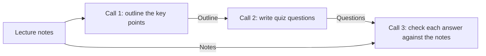
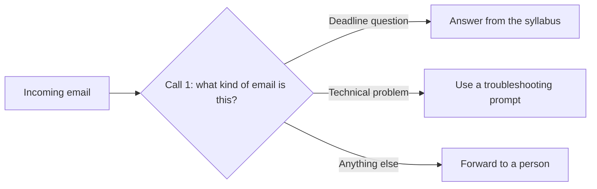
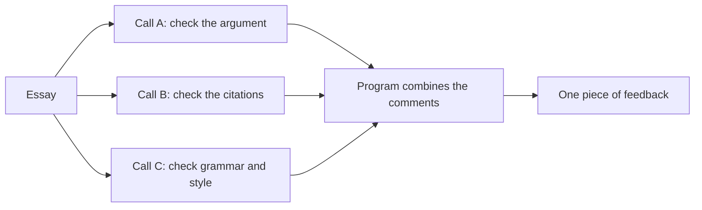

# Workflows and Agents
### Week 11
COSC-300/500 Applied AI Essentials

---

## This Is What Agents Are

Weeks 6–8, from the inside:

- When Cowork reads a file, that's a tool call.
- A connector is a set of tools, offered over MCP.
- An approval prompt is the harness pausing before a tool runs.
- The agent loop is this week's round trip, repeated until the task is done.

Nothing new is happening in an agent. It's the same request and response, many times over.

---

## An Agent Is a Short Loop

1. Send the task, the conversation, and the tool definitions
2. Model asks for a tool → run it, add the result, go to 1
3. Model answers without a tool → stop

The model supplies judgment. The harness supplies tools, permissions, and limits.

---

## Workflows vs Agents

| Workflow | Agent |
|---|---|
| **You** fix the steps in code | **The model** decides the steps |
| Predictable | Flexible |
| Easier to test | Harder to test |
| Cost known in advance | Cost varies |

Common workflow patterns: **chaining**, **routing**, **parallelization**.

---

## Chaining

Each call does one job, with a prompt written for that job. You can check the output between steps.

---

## Routing

A first call sorts the input. Easy cases can go to a small model, hard ones to a larger one or a person.

---

## Parallelization

Each call concentrates on one thing.

---

## Choose the Simplest Thing That Works

1. **One good call**, when a single well-written prompt does the job
2. **A workflow**, when the steps are always the same
3. **An agent**, when the steps depend on what turns up along the way

Workflows where you can, agents where you must. Each step up adds cost and makes testing harder.

<!-- Ask students which of the three their final project task needs. -->
