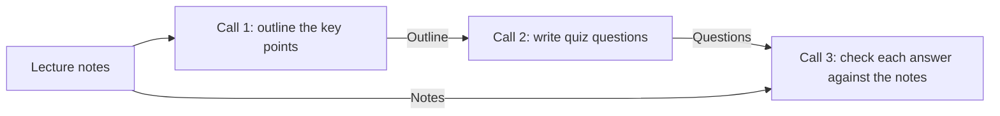
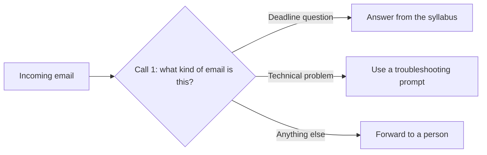
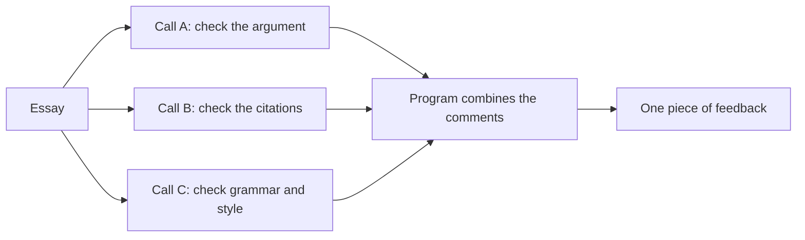

# Workflows and Agents
### Week 11
COSC-300/500 Applied AI Essentials

---

## This Is What Agents Are

Weeks 6–8, from the inside:

- Cowork reading a file = a tool call
- A connector = a set of tools over MCP
- An approval prompt = the harness pausing before a tool runs
- The agent loop = this round trip, repeated

---

## An Agent Is a Short Loop

1. Send the task, the conversation, and the tool definitions
2. Model asks for a tool → run it, add the result, go to 1
3. Model answers without a tool → stop

The model supplies judgment. The harness supplies tools, permissions, and limits.

---

## Workflows vs Agents

| Workflow | Agent |
|---|---|
| **You** fix the steps in code | **The model** decides the steps |
| Predictable | Flexible |
| Easier to test | Harder to test |
| Cost known in advance | Cost varies |

Common workflow patterns: **chaining**, **routing**, **parallelization**.

---

## Chaining

Each call does one job. You can check between steps.

---

## Routing

Easy cases to a small model, hard ones to a larger one.

---

## Parallelization

Each call concentrates on one thing.

---

## Choose the Simplest Thing That Works

1. **One good call**
2. **A workflow**, when the steps are always the same
3. **An agent**, when the steps depend on what turns up

Workflows where you can, agents where you must.

<!-- Ask students which of the three their final project task needs. -->
